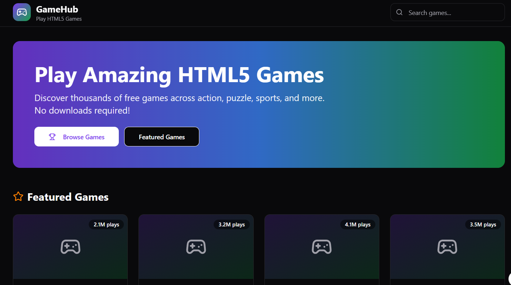

## Features

### Cannon Balls 3D:
- Implement physics-based cannonball simulation.
- Add collision detection and destruction of targets.
### Tower Crash 3D.
- Implement physics-based tower simulation.
- Add collision detection and scoring system.
### Moto X3M Pool Party:
- Implement physics-based motorcycle simulation.
- Add stunt and obstacle detection system.
### Western Sniper:
- Implement bullet trajectory simulation.
- Add target detection and scoring system.
### Bubble Shooter:
- Implement bubble shooting simulation.
- Add collision detection and removal of bubbles.
### Element Blocks:
- Implement block rotation and movement simulation.
- Add line clearing and scoring system.
### Garden Bloom:
- Implement match-3 gameplay simulation.
- Add tile swapping and garden growth mechanics.
### Color Fill 3D:
- Implement color filling simulation.
- Add shape recognition and level progression system.
### 3D Free Kick:
- Implement physics-based ball simulation.
- Add goal detection and scoring system.
### 8 Ball Billiards Classic:
- Implement physics-based ball simulation.
- Add scoring and game rules system.
### Table Tennis World Tour:
- Implement physics-based ball simulation.
- Add paddle movement and ball detection system.
### Solitaire Klondike:
- mplement card game rules and movement simulation.
- Add winning conditions and scoring system.
### Onet Connect Classic:
- Implement tile matching simulation.
- Add connection detection and level progression system.
### Totemia: Cursed Marbles:
- Implement match-3 gameplay simulation.
- Add marble movement and level progression system.
